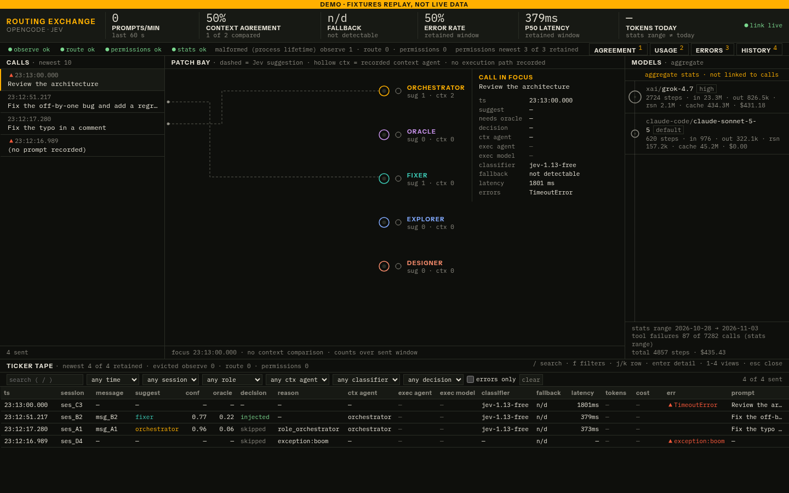
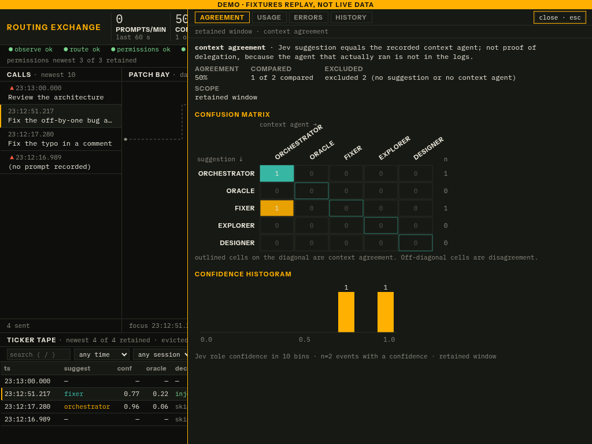

# opencode-routing-dashboard

A real-time, localhost-only switchboard for [OpenCode](https://opencode.ai) routing:
Jev suggestions, recorded context agents, route decisions, aggregate model usage and errors.
It does not invent execution agents, per-message model usage or fallback events that the logs cannot establish.

## Why

Multi-agent setups such as [oh-my-opencode-slim](https://github.com/alvinunreal/oh-my-opencode-slim)
spread work across roles (orchestrator, oracle, fixer, explorer, designer) and providers with
fallback chains. Without a view of what really happened, you can't tell whether a preset is good,
whether quota is burned in the wrong place, or whether the router agrees with the orchestrator.

## Status

Implementation progress is tracked in [docs/PLAN.md](docs/PLAN.md).
See [docs/SPEC.md](docs/SPEC.md) for source formats and evidence limits,
[docs/DESIGN.md](docs/DESIGN.md) for the switchboard system and
[docs/VERIFICATION.md](docs/VERIFICATION.md) for checks and screenshots.
Ranked limitations and process-evidence gaps are listed in [docs/KNOWN_ISSUES.md](docs/KNOWN_ISSUES.md).

## Run locally

Requires Bun >= 1.2. OpenCode is optional when using an offline stats file or disabling stats.

```sh
bun install --frozen-lockfile
bun run start
# open http://127.0.0.1:4777
```

`start` builds local assets and starts the server; `dev` watches server code after an initial client build.
After editing frontend code, rerun `bun run build` and refresh the browser. Nothing binds to a public interface.

### Configuration

Flags override environment variables. Run `bun src/cli.ts --help` for CLI options.

| Environment | Flag | Default |
|---|---|---|
| `ORD_STATE_DIR` | `--state-dir` | `~/.local/state/opencode` |
| `ORD_OBSERVE_PATH` | `--observe-path` | `<state-dir>/jev-observe.jsonl` |
| `ORD_ROUTE_PATH` | `--route-path` | `<state-dir>/jev-route.jsonl` |
| `ORD_PERMISSIONS_PATH` | `--permissions-path` | `<state-dir>/jev-permissions.jsonl` |
| `ORD_PORT` | `--port` | `4777` |
| `ORD_STATS_INTERVAL` | `--stats-interval` | `60` seconds |
| `ORD_STATS_COMMAND` | `--stats-command` | `opencode` executable, no shell |
| `ORD_STATS_FILE` | `--stats-file` | unset; validated JSON file instead of CLI |
| `ORD_STATS_ENABLED` | `--stats-enabled` | `true` |
| `ORD_SNAPSHOT_DIR` | `--snapshot-dir` | `<state-dir>/snapshots` |
| `ORD_MAX_RECORDS` | `--max-records` | `10000` per log source |
| `ORD_DEMO` | `--demo` | `false`; explicit fixture-replay label |

Paths support `~`. Missing log files are a normal silent-exchange state; the tailer notices later creation.
The app never reads credential files. OpenCode stats runs as a standalone child with catalog/update/LSP
downloads and telemetry exporters disabled; this is not an OS network sandbox for third-party plugins
or unrelated OpenCode processes. Offline mode avoids spawning OpenCode entirely.

### Anonymized demo

```sh
ORD_STATE_DIR=fixtures ORD_STATS_FILE=fixtures/stats.json ORD_DEMO=true bun run start
```

For arrivals over SSE, start with an empty temporary directory and replay fixtures into it:

```sh
demo_dir="$(mktemp -d)"
ORD_STATE_DIR="$demo_dir" ORD_STATS_FILE=fixtures/stats.json ORD_DEMO=true bun run start
# In another terminal, substitute the temporary directory printed/selected above:
bun scripts/replay.ts --dir /path/to/empty-demo-dir --interval-ms 500
```

Replay refuses existing output files. Demo data stays local and is visibly labeled.

### Verification

```sh
bun run typecheck
bun run lint
bun test
bun run build
```

Optional browser verification uses an already available Playwright installation and Chromium;
neither is a project dependency. Point `PLAYWRIGHT_MODULE_PATH` at its module entry file if needed:

```sh
PLAYWRIGHT_MODULE_PATH=/path/to/playwright/index.mjs CHROMIUM_PATH=/path/to/chromium \
  node scripts/verify-ui.mjs --url http://127.0.0.1:4777 --report /path/to/ui-report.json
```

Pass `--state-dir /path/to/temporary-demo-dir` to enable burst/render-limit append checks.
The verifier refuses writes unless the server is explicitly in DEMO mode and all source paths
match a temporary directory outside the repository. Do not point it at real logs.

The test suite uses anonymized fixtures and temporary directories, including a real random-port
append-to-SSE integration test. Readouts explicitly distinguish retained log windows, lifetime
malformed counts and the independent stats range. Byte-bounded detail windows report omissions;
full raw records remain inspectable for displayed events.

## Views

- **Flow:** live suggestion switchboard, recorded context jacks, aggregate model rail and filterable ticker.
- **Agreement:** context-only confusion matrix and confidence histogram; not a delegation success metric.
- **Usage:** models, providers and variants, with separate stats-range totals and reported costs.
- **Errors:** classifier/route failures, lifetime malformed counters, stats tool failures and permission verdicts.
- **History:** weekly stats snapshots; each point retains its own source range.

Shortcuts: `/` search, `f` filters, `j`/`k` rows, `Enter` details, `1`–`4` drawers, `Esc` close.
The detail drawer preserves raw records and a session timeline of transmitted events.





## Weekly history

Capture once from OpenCode or an explicit offline stats file:

```sh
bun run snapshot
# Offline example, writes only to the selected snapshot directory:
ORD_STATS_FILE=fixtures/stats.json ORD_SNAPSHOT_DIR=/path/to/snapshots bun run snapshot
```

The filename is the local Monday of the capture week. An existing week is never overwritten.
Atomic publication requires a filesystem supporting hard links (normal Linux/macOS local filesystems).
Unsupported filesystems fail explicitly without replacing an existing snapshot or leaving a partial final file.
The server only reads snapshots and refreshes History periodically. Up to 52 newest valid snapshots
fit within file/total byte limits; malformed and omitted counts are visible in source status.
Each snapshot keeps its own stats range, so overlapping ranges are not additive weekly totals.

## Package and optional systemd user units

```sh
bun pm pack --destination /path/to/output
```

The archive includes an executable `opencode-routing-dashboard` bin, server source, built assets,
local fonts/licenses and the units in `contrib/systemd/`. It excludes fixtures and tests. This PR
does not publish a registry package: `bunx opencode-routing-dashboard` is the intended published
entry point, not a claim that this branch is available on the registry.

For an installed executable on Linux, copy the three example units into your user systemd directory,
adjust their `PATH` and optional `ORD_*` environment settings, then explicitly enable the desired units:

```sh
mkdir -p ~/.config/systemd/user
cp contrib/systemd/opencode-routing-dashboard* ~/.config/systemd/user/
systemctl --user daemon-reload
systemctl --user enable --now opencode-routing-dashboard.service
systemctl --user enable --now opencode-routing-dashboard-snapshot.timer
```

The snapshot timer uses `OnCalendar=weekly` and `Persistent=true`. Both services need Bun and the
dashboard executable on their service `PATH`, and matching snapshot/state settings. No service is
installed or enabled by the app. macOS can run the CLI directly; systemd units are Linux-only.

## License

MIT
